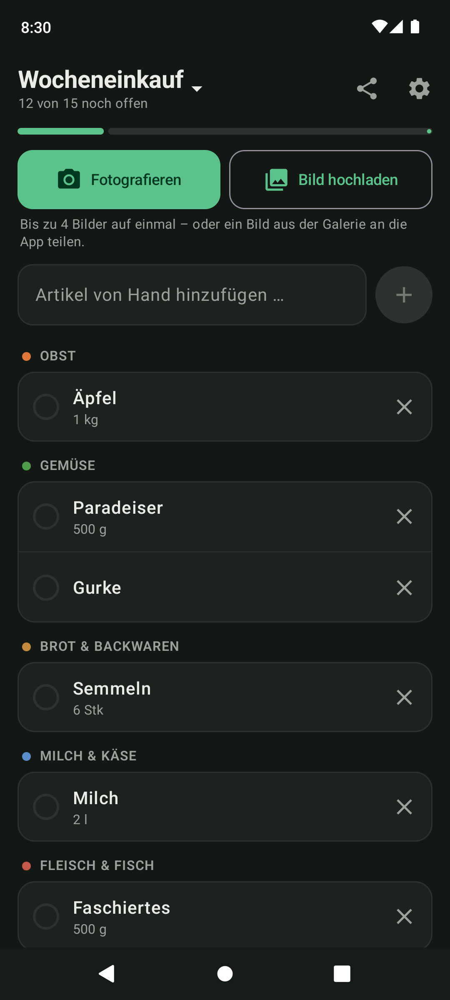
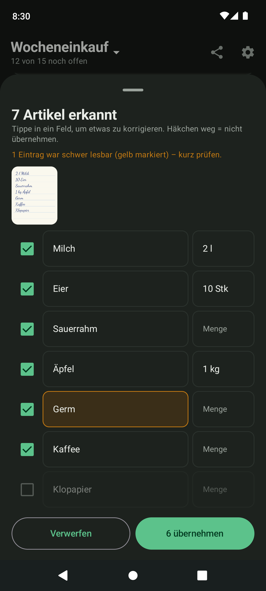
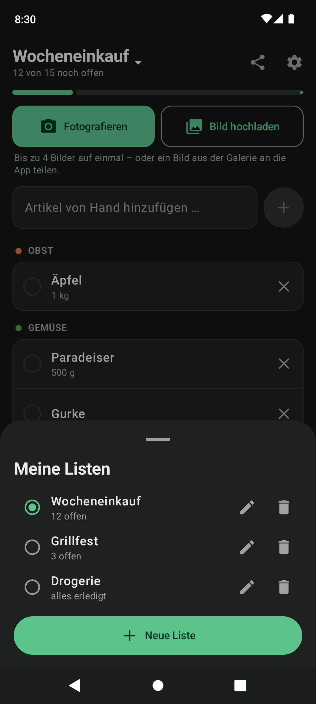
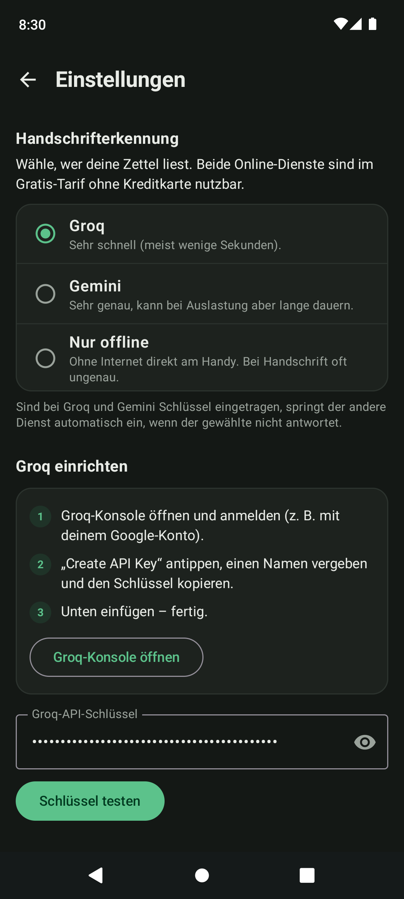
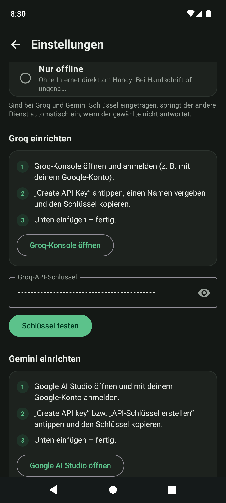
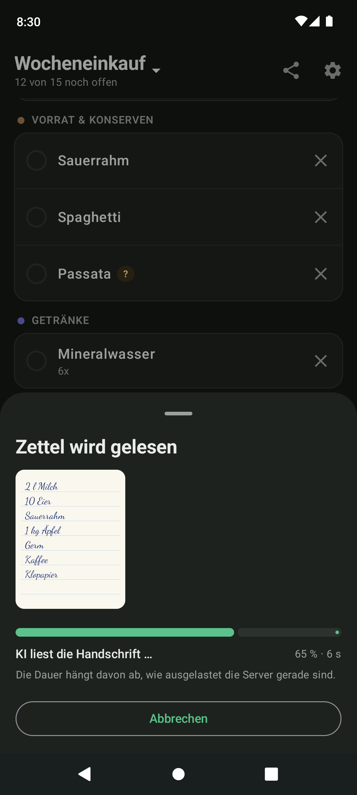
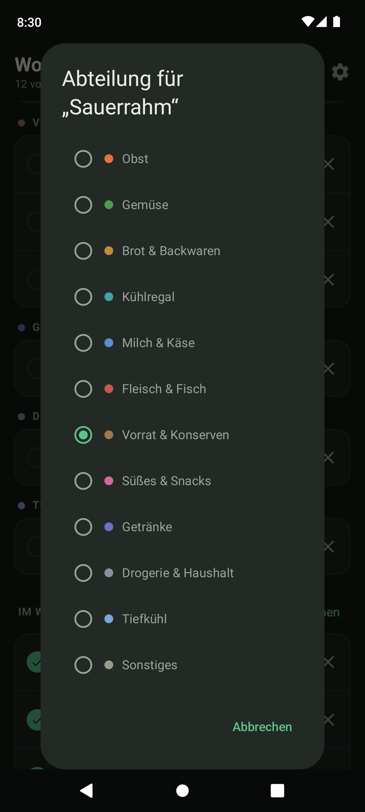
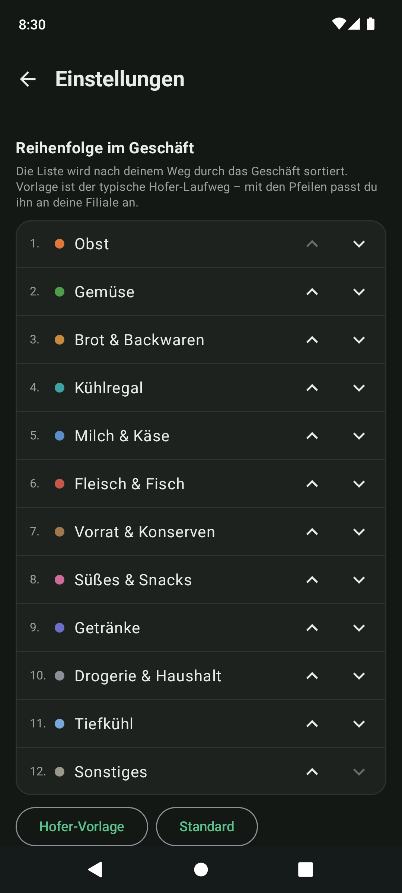
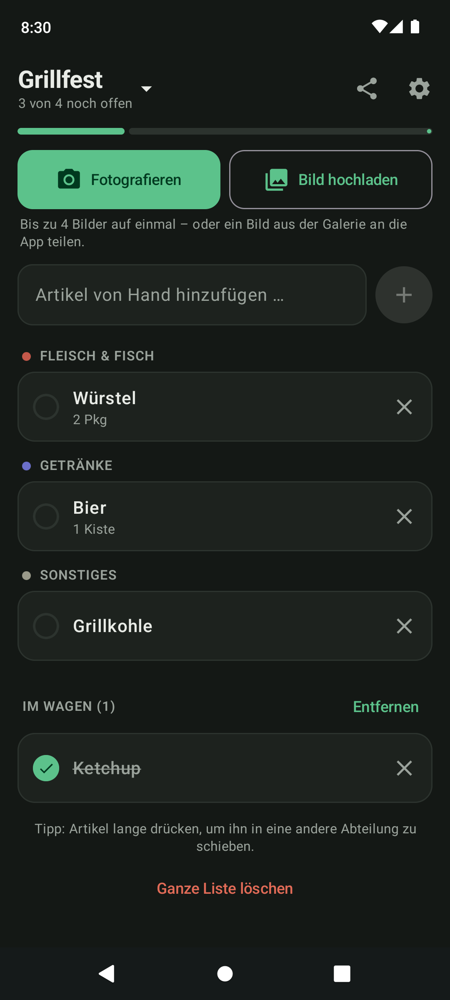

# 🛒 Einkaufszettel

**Handgeschriebenen Einkaufszettel fotografieren – fertig ist die Liste zum Abhaken.**

Einkaufszettel ist eine Android-App, die deinen Zettel (oder mehrere) per KI liest, die Artikel nach deinem Weg durchs Geschäft sortiert und als Liste zum Abhaken anlegt. Alle KI-Dienste laufen im **Gratis-Tarif ohne Kreditkarte**.

<p align="center">
  
  &nbsp;
  
  &nbsp;
  
</p>

---

## Inhalt

- [Funktionen](#funktionen)
- [Installation](#installation)
- [Einrichtung: Handschrifterkennung](#einrichtung-handschrifterkennung)
- [Bedienung](#bedienung)
  - [Zettel scannen](#1-zettel-scannen)
  - [Erkannte Einträge prüfen](#2-erkannte-einträge-prüfen)
  - [Einkaufen und abhaken](#3-einkaufen-und-abhaken)
  - [Artikel in eine andere Abteilung schieben](#4-artikel-in-eine-andere-abteilung-schieben)
  - [Reihenfolge im Geschäft (Laufweg)](#5-reihenfolge-im-geschäft-laufweg)
  - [Mehrere Listen](#6-mehrere-listen)
  - [Liste teilen](#7-liste-teilen)
  - [Hofer-Preise](#8-hofer-preise)
- [Abteilungen](#abteilungen)
- [Fehlerbehebung](#fehlerbehebung)
- [Datenschutz](#datenschutz)
- [Technik](#technik)
- [Versionsverlauf](#versionsverlauf)

---

## Funktionen

| | |
|---|---|
| 📷 **Scannen** | Zettel fotografieren oder bis zu 4 Bilder aus der Galerie hochladen – auch per „Teilen“ aus anderen Apps |
| 🤖 **Drei Erkennungsdienste** | **Groq** (sehr schnell), **Gemini** (sehr genau), **Offline** (ohne Internet, direkt am Handy) – mit automatischer Ausweichlösung |
| ✏️ **Prüfen vor dem Übernehmen** | Schwer lesbare Wörter sind gelb markiert, Namen und Mengen lassen sich korrigieren |
| 🗂️ **Nach Laufweg sortiert** | Liste nach Abteilungen in der Reihenfolge deines Geschäfts – Vorlage für **Hofer**, frei anpassbar |
| 🧠 **Lernt dazu** | Schiebst du „Sauerrahm“ einmal zu „Milch & Käse“, landet er dort auch beim nächsten Scan |
| 💶 **Hofer-Preise** | Preis zu jedem Artikel und geschätzte Summe – direkt aus dem Hofer-Sortiment auf hofer.at, Produkt per Antippen änderbar |
| 📝 **Mehrere Listen** | z. B. „Wocheneinkauf“, „Grillfest“, „Drogerie“ – anlegen, wechseln, umbenennen, löschen |
| ✅ **Abhaken** | Antippen = in den Wagen, Löschen mit „Rückgängig“, Fortschrittsbalken |
| 📤 **Teilen** | Offene Artikel als Text an WhatsApp, Signal & Co. |
| 🌙 **Hell & dunkel** | folgt dem System-Design |

---

## Installation

1. Die neueste APK unter **[Releases](../../releases/latest)** herunterladen (`Einkaufszettel-v1.0.X.apk`).
2. Am Handy öffnen. Beim ersten Mal fragt Android, ob der Browser bzw. Dateimanager **Apps aus unbekannten Quellen** installieren darf – erlauben.
3. Installieren, fertig.

**Updates:** Neue Version einfach über die alte installieren – die Listen und Einstellungen bleiben erhalten (alle Versionen sind mit demselben Schlüssel signiert).

**Voraussetzung:** Android 9 oder neuer, ARM-Handy (praktisch alle Smartphones).

---

## Einrichtung: Handschrifterkennung

Unter **⚙️ Einstellungen → Handschrifterkennung** wählst du, wer deine Zettel liest:

| Dienst | Geschwindigkeit | Genauigkeit bei Handschrift | Kosten | Internet |
|---|---|---|---|---|
| **Groq** | ⚡ sehr schnell (meist wenige Sekunden) | gut | Gratis-Tarif, keine Kreditkarte | ja |
| **Gemini** | 🐢 je nach Auslastung langsam | sehr gut | Gratis-Tarif, keine Kreditkarte | ja |
| **Nur offline** | schnell | mäßig (gut bei Druckschrift) | kostenlos, kein Konto | nein |

> 💡 **Tipp:** Trag **beide** Schlüssel ein. Antwortet der gewählte Dienst nicht (überlastet, Kontingent aufgebraucht, keine Verbindung), springt der andere automatisch ein.

<p align="center">
  
  &nbsp;
  
</p>

### Groq-Schlüssel holen

1. In der App **„Groq-Konsole öffnen“** antippen (öffnet `console.groq.com/keys`).
2. Anmelden, z. B. mit dem Google-Konto.
3. **„Create API Key“** → beliebigen Namen vergeben → Schlüssel **kopieren** (beginnt mit `gsk_`).
4. In der App ins Feld **Groq-API-Schlüssel** einfügen.
5. **„Schlüssel testen“** – es erscheint z. B. `Schlüssel funktioniert ✓ (0,4 s, Modell qwen/qwen3.8-27b verfügbar)`.
6. Oben **Groq** auswählen.

### Gemini-Schlüssel holen

1. In der App **„Google AI Studio öffnen“** antippen (öffnet `aistudio.google.com/apikey`).
2. Mit dem Google-Konto anmelden.
3. **„Create API key“** bzw. **„API-Schlüssel erstellen“** → Schlüssel **kopieren** (beginnt mit `AIza`).
4. In der App ins Feld **Gemini-API-Schlüssel** einfügen und **„Schlüssel testen“**.
5. Oben **Gemini** auswählen (oder Groq lassen – dann ist Gemini die Ausweichlösung).

### Für Fortgeschrittene

Unter **Für Fortgeschrittene** lässt sich das Modell ändern. Standard:

- Groq: `qwen/qwen3.8-27b` (weicht automatisch auf andere Groq-Bildmodelle aus)
- Gemini: `gemini-flash-latest` (die App fragt bei Google ab, welche Flash-Modelle verfügbar sind, und weicht bei Bedarf darauf aus)

---

## Bedienung

### 1. Zettel scannen

| Weg | So geht's |
|---|---|
| **Fotografieren** | Kamera öffnet sich, Zettel möglichst gerade von oben und bei gutem Licht fotografieren |
| **Bild hochladen** | Bis zu **4 Bilder** auf einmal auswählen (z. B. zwei Zettel oder Vorder- und Rückseite) – sie werden zu **einer** Liste zusammengefasst, doppelte Artikel nur einmal |
| **Teilen** | In der Galerie ein Foto → **Teilen → „Zur Einkaufsliste“** |

Neue Artikel landen immer in der **gerade geöffneten Liste**.

Während der Erkennung zeigt ein **Fortschrittsbalken** den aktuellen Schritt (*Bild wird vorbereitet → Wird hochgeladen → KI liest die Handschrift → Liste wird erstellt*), die Prozent und die vergangenen Sekunden. Muss die App neu versuchen oder auf ein anderes Modell bzw. den anderen Dienst ausweichen, steht das dort ebenfalls.

<p align="center"></p>

### 2. Erkannte Einträge prüfen

Bevor etwas auf die Liste kommt, siehst du alle erkannten Artikel:

- **Gelb markiert** = schwer lesbar, kurz kontrollieren.
- **In ein Feld tippen**, um Name oder Menge zu korrigieren.
- **Häkchen entfernen** = Artikel nicht übernehmen.
- **„X übernehmen“** fügt sie zur Liste hinzu. Artikel, die schon offen auf der Liste stehen, werden nicht doppelt angelegt.

Die KI trennt Mengen vom Namen („2 l Milch“ → *Milch*, Menge *2 l*), korrigiert Rechtschreibung, ignoriert durchgestrichene Einträge und ordnet jeden Artikel einer Abteilung zu.

<p align="center"></p>

### 3. Einkaufen und abhaken

- **Artikel antippen** → abgehakt, er wandert nach unten in **„Im Wagen“**. Nochmal antippen holt ihn zurück.
- **×** löscht einen Artikel – mit **„Rückgängig“** in der Leiste unten.
- **„Entfernen“** bei „Im Wagen“ räumt alle erledigten Artikel weg.
- **„Ganze Liste löschen“** ganz unten (mit Rückfrage).
- **Von Hand hinzufügen:** ins Feld z. B. `2 Milch`, `Mehl 1 kg` oder `500g Faschiertes` tippen – die Menge wird automatisch erkannt, die Abteilung über Stichwörter geraten.
- Ein **„?“** neben einem Artikel heißt: war beim Scannen schwer lesbar.

<p align="center"></p>

### 4. Artikel in eine andere Abteilung schieben

**Artikel lange drücken** → neue Abteilung antippen.

Die App **merkt sich das**: Steht derselbe Artikel wieder auf einem gescannten Zettel oder trägst du ihn von Hand ein, landet er automatisch in deiner gewählten Abteilung – deine Zuordnung hat Vorrang vor der KI.

<p align="center"></p>

### 5. Reihenfolge im Geschäft (Laufweg)

Die Liste ist nach Abteilungen in der Reihenfolge sortiert, in der du durchs Geschäft gehst. Unter **⚙️ Einstellungen → Reihenfolge im Geschäft**:

- mit **▲ / ▼** jede Abteilung verschieben – die Liste sortiert sich sofort um,
- **„Hofer-Vorlage“** setzt den typischen Hofer-Laufweg,
- **„Standard“** setzt die Grundreihenfolge.

**Hofer-Vorlage:** Obst → Gemüse → Brot & Backwaren → Kühlregal → Milch & Käse → Fleisch & Fisch → Vorrat & Konserven → Süßes & Snacks → Getränke → Drogerie & Haushalt → Tiefkühl → Sonstiges

> Der Anfang ist an das Hofer-Filialkonzept angelehnt (Marktplatz mit Obst & Gemüse, Backbox, direkt danach die Coolbox). Der Rest folgt dem üblichen Diskonter-Aufbau – da sich Filialen unterscheiden, einfach an die eigene anpassen.

<p align="center"></p>

### 6. Mehrere Listen

**Auf den Listennamen oben tippen** (▾) → **Meine Listen**:

- Liste antippen = öffnen. Neben jeder Liste steht, wie viele Artikel offen sind.
- **„+ Neue Liste“** – Namen vergeben, z. B. *Grillfest* oder *Drogerie*.
- **✎** umbenennen, **🗑** löschen (mit Rückfrage; die letzte Liste wird nur geleert).

Reihenfolge im Geschäft, gemerkte Abteilungen und Einstellungen gelten für **alle** Listen.

<p align="center">
  
  &nbsp;
  
</p>

### 7. Liste teilen

Das **Teilen-Symbol** oben schickt alle **offenen** Artikel als Text, nach Abteilungen sortiert und mit dem Listennamen als Überschrift:

```
Wocheneinkauf

Obst:
☐ Äpfel (1 kg)

Gemüse:
☐ Paradeiser (500 g)
☐ Gurke
…
```

### 8. Hofer-Preise

Neben jedem Artikel steht der **Hofer-Preis**, oben im Titel und unten in der Liste die **geschätzte Summe** (*noch zu kaufen*, *im Wagen*, *gesamt*).

- **Woher:** Die App lädt das Hofer-Sortiment direkt von **hofer.at** (alle Produktkategorien, je 60 Produkte pro Seite) und speichert es am Handy. Beim ersten Öffnen und danach **einmal pro Woche** automatisch, sonst unter *Einstellungen → Hofer-Preise → Jetzt aktualisieren*.
- **Zuordnung:** Die App sucht zu jedem Artikel das passendste Hofer-Produkt (Name, Abteilung, Reihenfolge bei Hofer). Automatisch zugeordnete Produkte sind mit **≈** markiert, z. B. *≈ MILSANI Frische Vollmilch 3,5% Fett*.
- **Ändern:** Auf den **Preis tippen** → im Hofer-Sortiment suchen und das richtige Produkt wählen. Die Wahl wird für diesen Artikel **gemerkt**, auch auf künftigen Listen. **„Ohne Preis“** blendet den Preis aus, **„Automatisch“** überlässt die Wahl wieder der App.
- **Menge:** Bei Stückzahlen (`2`, `6x`, `3 Stk`, `2 Dosen`) wird der Preis multipliziert, bei Gewichten und Litern nicht.
- **Ein- und ausschalten:** *Einstellungen → Hofer-Preise → Preise anzeigen*.

> Preise ohne Gewähr: Aktionspreise in der Filiale, Obst und Gemüse nach Gewicht sowie Pfand können abweichen. Hofer schützt seine Website gegen Bots; die App ruft sie deshalb wie Chrome am Handy auf und weicht notfalls auf ein unsichtbares Browserfenster aus.

---

## Abteilungen

| Farbe | Abteilung | Beispiele |
|---|---|---|
| 🟠 | Obst | Äpfel, Bananen, Zitronen, Beeren |
| 🟢 | Gemüse | Paradeiser, Gurke, Zwiebeln, Erdäpfel, Kräuter |
| 🟤 | Brot & Backwaren | Semmeln, Brot, Toast, Kipferl |
| 🔵 | Kühlregal | Fertiggerichte, Aufstriche, To-go |
| 🔵 | Milch & Käse | Milch, Butter, Joghurt, Topfen, Eier, Käse |
| 🔴 | Fleisch & Fisch | Faschiertes, Hendl, Wurst, Lachs |
| 🔵 | Tiefkühl | Pizza, Pommes, Fischstäbchen, Eis |
| 🟤 | Vorrat & Konserven | Nudeln, Reis, Mehl, Öl, Kaffee, Dosen |
| 🟣 | Getränke | Wasser, Saft, Bier, Wein |
| 🩷 | Süßes & Snacks | Schokolade, Chips, Kekse |
| ⚪ | Drogerie & Haushalt | Klopapier, Waschmittel, Zahnpasta |
| ⚪ | Sonstiges | alles andere |

---

## Liste mit dem Spiegel teilen

An der Wohnungstür fällt einem ein, was fehlt — und dort sagt niemand „Setz Milch auf die Einkaufsliste“. Mit einem geteilten Nextcloud-Ordner genügt **„Kauz, merk dir Milch“** am Smart-Mirror im Vorzimmer, und im Hofer steht es hier auf der Liste.

**Einrichten:**

1. In Nextcloud einen Ordner anlegen, z. B. `Einkaufsliste`.
2. Als **öffentlichen Link** teilen, dabei **„Bearbeiten erlauben“** anhaken und ein **Freigabepasswort** setzen.
3. Den Link (`https://cloud…/s/AbC123`) und das Passwort in *Einstellungen → Liste mit dem Spiegel teilen* eintragen.
4. Beim Sprachassistenten denselben Link eintragen — siehe [`docs/einkaufsordner.md`](https://github.com/wuse123mann/kauz2/blob/update-kauz/docs/einkaufsordner.md) im Kauz-Repo.

Abgeglichen wird beim Öffnen der App und über das ⟳ in der Titelzeile. Leeres Linkfeld schaltet das Teilen ab.

**Wie es ohne Konflikte geht:** Jede Datei im Ordner hat genau einen Schreiber. `listen.json` gehört dieser App; der Assistent liest sie nur. Der Ordner `posteingang/` gehört ihm; pro Zuruf landet dort eine Datei von achtzig Byte, die diese App übernimmt und wegräumt. So begegnen sich die Schreibvorgänge nie, und keiner überschreibt still die Änderung des anderen. Die Reihenfolge der Zettel steckt im Dateinamen und wird eingehalten — „dazu Milch, weg Milch, dazu Milch“ endet mit Milch auf der Liste.

Die Liste bleibt dabei lokal die Wahrheit: Ohne Empfang funktioniert alles weiter, abgeglichen wird, sobald es wieder geht.

**Zu beachten:** Ein öffentlich beschreibbarer Link ist öffentlich beschreibbar — wer die URL hat, liest und schreibt diesen Ordner. Darum das Freigabepasswort, und nichts anderes als die Einkaufsliste hineinlegen.

---

## Fehlerbehebung

| Meldung | Ursache | Lösung |
|---|---|---|
| **Gratis-Kontingent aufgebraucht** (429) | Zu viele Anfragen in kurzer Zeit | Eine Minute warten; zweiten Dienst eintragen, dann springt der ein |
| **Server überlastet** (503) | Der Anbieter ist gerade ausgelastet (bei Gemini häufig) | Die App versucht es selbst erneut und weicht aus; sonst kurz warten oder auf Groq wechseln |
| **Schlüssel ungültig / abgelehnt** (400/401/403) | Tippfehler oder Schlüssel gelöscht | Schlüssel neu kopieren, „Schlüssel testen“ |
| **Kein passendes Modell gefunden** | Modellname veraltet | Unter „Für Fortgeschrittene“ den Standard eintragen |
| **Adresse des Servers konnte nicht ermittelt werden** (UnknownHost) | DNS blockiert oder gestört | Werbeblocker / „Privates DNS“ / DNS-Filter im Heimnetz (z. B. Pi-hole, pfBlockerNG) prüfen; die App versucht zusätzlich verschlüsseltes DNS über Cloudflare/Google |
| **Verbindung abgelehnt / Zeitüberschreitung** | VPN, Firewall-App oder gesperrte Datennutzung | Einstellungen → Apps → Einkaufszettel → Mobile Daten & WLAN erlauben; VPN/Blocker testweise aus |
| **Keine Einträge gefunden** | Foto unscharf, dunkel oder schräg | Bei gutem Licht gerade von oben fotografieren |
| **Offline erkannt – ungenau** | Kein Schlüssel eingetragen | Groq- oder Gemini-Schlüssel eintragen |

Jede Netzwerk-Fehlermeldung enthält unten eine Zeile **„Technisch nach … s: …“** – die hilft bei der Fehlersuche. Der Schlüssel-Test zeigt außerdem, über welchen Weg die Verbindung lief (*Chrome-Netz* oder *OkHttp*).

---

## Datenschutz

- Deine **Listen bleiben nur auf deinem Handy** (App-Speicher). Es gibt kein Konto und keinen eigenen Server.
- Zur Erkennung wird **nur das Foto** an den gewählten Dienst geschickt (Groq bzw. Google). Im **Gemini-Gratis-Tarif darf Google die Daten zur Verbesserung seiner Dienste verwenden.**
- Im Modus **„Nur offline“** verlässt nichts das Handy.
- Die API-Schlüssel liegen nur lokal in den App-Einstellungen.

---

## Technik

### Überblick

| | |
|---|---|
| Sprache / UI | Kotlin, Jetpack Compose, Material 3 |
| Android | minSdk 28 (Android 9), targetSdk 35 |
| Architektur | eine Activity, ein `AndroidViewModel`, Compose-State |
| Speicher | `listen.json` im App-Speicher, Einstellungen in `SharedPreferences` |
| Erkennung online | Groq (OpenAI-kompatible API), Google Gemini API |
| Erkennung offline | Google ML Kit Text Recognition (gebündelt, kein Play-Dienst nötig) |
| Netzwerk | Cronet (Chrome-Netzwerk-Stack über Google-Play-Dienste, QUIC/HTTP3), Ausweich auf OkHttp |
| Build | GitHub Actions, signierte Release-APK bei jedem Push |

### Projektstruktur

```
app/src/main/java/com/wuse123mann/einkaufszettel/
├── MainActivity.kt     Einstieg, Teilen-Ziel für Bilder, Farbschema (hell/dunkel)
├── MainViewModel.kt    Zustand: Listen, Scan-Ablauf, Fortschritt, Einstellungen, Dienst-Reihenfolge
├── Ui.kt               Alle Bildschirme: Liste, Listen-Auswahl, Scan/Prüfen, Einstellungen
├── Model.kt            Item, Liste, Abteilungen, Stichwort-Zuordnung, Mengen-Erkennung, Hofer-Laufweg, JSON
├── Store.kt            Speichern/Laden der Listen und Einstellungen (inkl. Übernahme alter Daten)
├── Recognizer.kt       Gemini-Anbindung, Prompt, Antwort-Auswertung, Offline-Leser (ML Kit), Bild laden
├── Hofer.kt            Hofer-Sortiment von hofer.at laden (Kategorieseiten, Bot-Schutz-Ausweich per WebView), Kacheln auslesen, Produkte zuordnen
├── Groq.kt             Groq-Anbindung (Bildmodelle, max. 3 Bilder pro Anfrage, Modell-Ausweich)
└── Netz.kt             HTTP über Cronet/OkHttp mit Upload-Fortschritt, Ausweich-DNS (DNS-over-HTTPS)

app/src/androidTest/…/ScreenshotTest.kt   erzeugt die Screenshots in docs/screenshots
.github/workflows/build.yml               baut die APK und legt ein Release an
.github/workflows/screenshots.yml         startet einen Emulator und nimmt die Screenshots auf
keystore/                                 Signierschlüssel (Repo muss privat bleiben!)
```

### Ablauf einer Erkennung

1. Bilder laden und auf max. 1600 px verkleinern (`ImageDecoder`, EXIF-Drehung wird berücksichtigt), als JPEG (Qualität 80) kodieren.
2. Dienst-Reihenfolge bestimmen: gewählter Dienst zuerst, der andere als Ausweich (nur wenn ein Schlüssel eingetragen ist). Ohne Schlüssel → offline.
3. **Groq:** `POST /openai/v1/chat/completions` mit Text + Bildern (`image_url` als Data-URI), `response_format: json_object`, `reasoning_effort: none` (wird bei Ablehnung weggelassen). Mehr als 3 Bilder → mehrere Anfragen, Ergebnisse werden zusammengeführt.
4. **Gemini:** `POST /v1beta/models/{modell}:generateContent` mit `inline_data`, `responseMimeType: application/json`, `thinkingLevel: low` (wird bei Ablehnung weggelassen). Kandidaten: eingestelltes Modell → `gemini-flash-latest` → `gemini-flash-lite-latest` → per `GET /v1beta/models` gefundene Flash-Modelle (neueste zuerst).
5. Fehlerbehandlung: 5xx → ein weiterer Versuch nach Pause, dann nächstes Modell; 404/429 → nächstes Modell; Schlüssel-Fehler → sofort melden. Scheitert ein Dienst ganz, übernimmt der andere.
6. Antwort als JSON auswerten:
   ```json
   {"items":[{"name":"Milch","menge":"2 l","kategorie":"Milch & Käse","unsicher":false}]}
   ```
7. Abteilung: gemerkte Zuordnung des Nutzers > Vorschlag der KI > Stichwort-Raten.

### Netzwerk

Manche Handys bzw. Netze hatten Probleme, die Google-API zu erreichen (Zeitüberschreitungen, DNS-Fehler), obwohl der Browser funktionierte. Deshalb:

- **Cronet** (der Netzwerk-Stack von Chrome, über die Google-Play-Dienste) ist der Standardweg – mit QUIC/HTTP3 und parallelen Verbindungsversuchen wie im Browser.
- Scheitert Cronet, wird die Anfrage über **OkHttp** wiederholt.
- OkHttp nutzt ein eigenes DNS: System-DNS → zuletzt funktionierende Adresse → **DNS-over-HTTPS** über Cloudflare (`1.1.1.1`) bzw. Google (`8.8.8.8`).
- Der Upload wird in 16-KB-Stücken geschrieben, daraus entsteht der Fortschritt beim Hochladen.

### Datenformat

`files/listen.json`:

```json
[
  {
    "id": "…",
    "name": "Wocheneinkauf",
    "items": [
      {"id": "…", "name": "Milch", "menge": "2 l", "kat": "Milch & Käse", "done": false, "unsicher": false}
    ]
  }
]
```

Hofer-Sortiment: `files/hofer.json` (`stand` + Produkte mit Name, Marke, Größe, Preis, Grundpreis, Abteilung, URL).

Einstellungen (`SharedPreferences` „einstellungen“): `preiseAn`, `preisWahl` (JSON-Objekt *Artikelname → Hofer-Produkt-URL*), `dienst`, `groqKey`, `groqModell`, `apiKey` (Gemini), `modell`, `reihenfolge` (JSON-Array), `gelernteKategorien` (JSON-Objekt *Artikelname → Abteilung*), `aktiveListe`.

Ältere Daten werden beim Start automatisch übernommen: die frühere Einzel-Liste (`liste.json`) wird zur Liste „Einkaufsliste“, die alte Abteilung „Obst & Gemüse“ wird auf „Obst“ bzw. „Gemüse“ aufgeteilt.

### Bauen

**Automatisch:** Jeder Push auf `main` startet [`build.yml`](.github/workflows/build.yml): Gradle 8.11.1, JDK 17, `assembleRelease`. Die APK wird mit `keystore/einkaufszettel.jks` signiert und als Release `v1.0.<Build-Nummer>` veröffentlicht. Die Release-APK enthält nur ARM-Bibliotheken (`arm64-v8a`, `armeabi-v7a`), das hält sie bei rund 23 MB.

**Lokal:**

```bash
gradle :app:assembleRelease      # APK: app/build/outputs/apk/release/app-release.apk
```

oder das Projekt in Android Studio öffnen.

### Screenshots neu erzeugen

Die Bilder in `docs/screenshots` stammen aus der echten App: [`screenshots.yml`](.github/workflows/screenshots.yml) startet einen Android-Emulator (API 33, Dunkelmodus), [`ScreenshotTest.kt`](app/src/androidTest/java/com/wuse123mann/einkaufszettel/ScreenshotTest.kt) füllt die App mit Beispieldaten, klickt sich durch und fotografiert den Bildschirm. Der Workflow committet die Bilder anschließend selbst.

Neu erzeugen: **Actions → Screenshots → Run workflow** (läuft außerdem automatisch, wenn sich der Test oder der Workflow ändert).

---

## Versionsverlauf

| Version | Neu |
|---|---|
| 1.0.2 | Erste Version: Zettel fotografieren/hochladen, Erkennung mit Gemini oder offline, Liste nach Abteilungen, Abhaken, Teilen |
| 1.0.3 | APK halbiert (nur ARM) |
| 1.0.4 | Genaue Fehlermeldungen bei Verbindungsproblemen |
| 1.0.5 | Netzwerk auf OkHttp, schneller Schlüssel-Test |
| 1.0.6 | Bei Überlastung (503) neuer Versuch und Ausweich-Modell |
| 1.0.7 | Verfügbare Gemini-Modelle werden automatisch ermittelt |
| 1.0.8 | Ausweich-DNS (DNS-over-HTTPS) |
| 1.0.9 | Verbindung über Cronet (wie Chrome) |
| 1.0.10 | Fortschrittsbalken mit Schritten; schnellere Erkennung |
| 1.0.11 | **Groq** als schneller Erkennungsdienst, automatische Ausweichlösung Groq ↔ Gemini |
| 1.0.12 | Sortierung nach Laufweg, **Hofer-Vorlage**, Reihenfolge anpassbar |
| 1.0.13 | Artikel per langem Druck in andere Abteilung schieben, App merkt sich das |
| 1.0.14 | **Obst** und **Gemüse** getrennt |
| 1.0.15 | **Mehrere Listen** |
| 1.0.16+ | Dokumentation mit Screenshots, Screenshot-Test im Emulator |
| neu | **Hofer-Preise** zu jedem Artikel, Summe, Produktwahl per Antippen |
